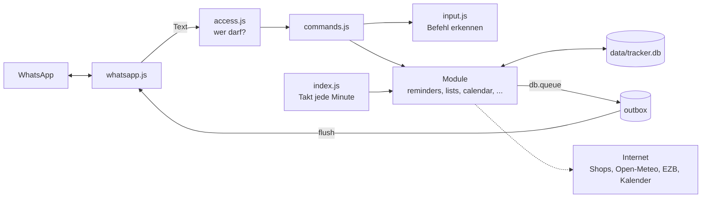

# Architektur

Für alle, die am Code arbeiten. Wie man den Bot benutzt, steht im [README](../README.md), die Regeln für Änderungen in [CONTRIBUTING.md](../CONTRIBUTING.md).

## Auf einen Blick

Ein einzelner Node.js-Prozess ohne Server und ohne Build-Schritt. Er hält eine WhatsApp-Verbindung, speichert alles in einer SQLite-Datei und prüft jede Minute, ob etwas zu senden ist.

## Start

| Weg | Einstieg | Wofür |
|---|---|---|
| `start.cmd` | `cli.js` → `index.js` | Windows-Menü, fragt bei Abmeldung und Absturz nach |
| Docker | `container.js` → `index.js` | Server. `supervise.js` zeigt nach einer Abmeldung einen neuen QR-Code und wartet bei Fehlern, die ein Neustart nicht behebt |
| `npm start` | `index.js` | Entwicklung |
| `npm run check -- <Link>` | `check.js` | einen Shop-Link ohne WhatsApp testen |

`index.js` liest die `.env` (`config.js`), sperrt `data/instance.lock` gegen eine zweite Instanz, öffnet die Datenbank, verbindet WhatsApp und startet den Takt. Die Exit-Codes in `exit-codes.js` sagen Menü und Container, warum der Bot endete.

## Eine Nachricht von Anfang bis Ende

1. **Empfang** (`whatsapp.js`): nur Text bis 4000 Zeichen, nicht älter als ein Tag, nicht von vor der Installation. Eigene Antworten beginnen mit `🤖 ` und werden übersprungen, damit der Chat „Nachricht an dich selbst“ nicht mit sich selbst redet. Sprachnachrichten werden, wenn die Spracherkennung installiert ist, heruntergeladen, in `speech.js` lokal mit Whisper transkribiert und mit `cleanTranscript` aufbereitet (Zahlwörter, erfundene Untertitel). Danach laufen sie wie getippter Text weiter.
2. **Zugriff** (`access.js`): Gruppen, fremde Nummern und Chats des Besitzers mit anderen ergeben `null`. Ergebnis ist `{ user, chat, self }`, wobei `user` immer die Telefonnummer ist, auch wenn WhatsApp eine LID schickt.
3. **Einmal verarbeiten:** `db.claimMessage` verhindert doppelte Antworten, wenn WhatsApp eine Nachricht erneut zustellt. Pro Nutzer läuft eine Nachricht nach der anderen.
4. **Befehl** (`commands.js` → `handle`):
   - Zuerst die Antwort auf „Wann soll ich dich erinnern?“ und ein `ja` auf „Meintest du …?“.
   - Dann `rephrase` (`phrases.js`): ganze Sätze werden zur kurzen Form („was muss ich einkaufen?“ → `einkauf`). Ein Ergebnis mit `sure` ist eine klare Frage an den Bot und wird auch im Chat mit sich selbst beantwortet; `silent` (bei „ok“, „👍“) heißt keine Antwort; `chatOnly` gilt nicht im Chat mit sich selbst.
   - Vorab ohne Befehlswort: ein Kalender-Link allein, `= 12*3`, `100 usd in eur`.
   - Sonst zerlegt `parseInput` (`input.js`) den Text in `{ action, ref, value }`. Befehlswörter werden vorher mit `fold` vereinheitlicht (klein, ohne Umlaute), so passt `rueckgaengig` zu `rückgängig`. Aktionen in `FREE_TEXT` bekommen den Rest als freien Text.
   - Nichts erkannt: ein Tippfehler-Vorschlag, passende Notizen (`lists.related`) oder „nicht verstanden“.
   - Das passende Modul antwortet mit einem Text, einem Bild (`{ text, image }`) oder einer Datei (`{ text, file }`).
5. **Antwort:** sofort senden. Klappt das nicht, landet ein Text in der Outbox und geht später raus.

### Stiller Modus

Im Chat mit sich selbst schreibt man auch Notizen, die nicht für den Bot sind. Deshalb bekommt jeder Befehl `quiet`. Ist es gesetzt und der Text kein eindeutiger Befehl, antwortet das Modul `null` und der Bot schweigt. Neue Befehle müssen das beachten.

## Takt (`index.js`, jede Minute)

| Schritt | Modul | Sendet |
|---|---|---|
| Sicherung | `backup.js` | nichts, einmal am Tag nach `data/backup` |
| Erinnerungen | `reminders.js` | fällige, auch in der Ruhezeit |
| Übersicht | `report.js` | Preisübersicht zum eingestellten Termin |
| Geburtstage | `birthdays.js` | 3 Tage vorher und am Tag um 9 Uhr |
| Monatsrückblick | `expenses.js` | Ausgaben des Vormonats |
| Briefing | `briefing.js` | Wetter, Termine, Erinnerungen, Listen, Preise |
| Kalender-Hinweise | `calendar.js` | vor Terminen, höchstens alle 15 Minuten geladen |
| Preisprüfung | `tracker.js` | Preisalarme |

Jeder Schritt hat ein eigenes `try`. Ein Fehler in einem Teil hält die anderen nicht auf.

## Outbox statt direktem Senden

Alles, was nicht direkt auf eine Nachricht antwortet, geht über `db.queue(user, text, { at, urgent })` in die Tabelle `outbox`. `flush()` in `whatsapp.js` sendet sie, sobald WhatsApp verbunden ist.

- **Kein Verlust:** War der PC aus oder WhatsApp getrennt, kommt die Nachricht später. Ist sie älter als 30 Minuten, steht „Stand: …“ darunter.
- **Ruhezeit:** Nicht dringende Nachrichten warten bis zum Ende der Ruhezeit. Erinnerungen sind `urgent`.
- **Nur für Erlaubte:** Wird eine Nummer aus `ALLOWED_NUMBERS` entfernt, verfallen ihre Nachrichten.
- **Einmalig:** `db.claimOnce(user, key)` stellt sicher, dass z. B. ein Geburtstagsgruß nur einmal kommt, auch nach einem Neustart.

## Daten

Eine Datei `data/tracker.db` (SQLite über `node:sqlite`, WAL-Modus). Jede Tabelle hat eine Spalte `user`, jede Abfrage filtert danach.

| Tabellen | Inhalt |
|---|---|
| `products`, `history`, `purchases` | Preistracker |
| `reminders` | Erinnerungen mit Regel für Wiederholungen |
| `items`, `notes` | Einkaufsliste, To-dos, Notizen |
| `calendars`, `calendar_alerts` | Kalender-Links (geheim!) und schon gesendete Hinweise |
| `birthdays` | Geburtstage |
| `expenses`, `budgets` | Haushaltsbuch |
| `settings` | pro Nutzer: Ruhezeit, Übersicht, Briefing, Ort, offene Rückfrage |
| `outbox`, `once`, `messages` | Versand, Einmal-Marken, gesendete Nachrichten für WhatsApp-Wiederholungen |
| `trash` | das zuletzt Gelöschte pro Nutzer, für `rückgängig` |
| `meta` | z. B. Installationszeitpunkt |

- **Nummern pro Nutzer:** Listen, Notizen und Erinnerungen zählen pro Person ab 1, damit `erledigt 2` zu dem passt, was die Person sieht.
- **Neue Spalten** kommen über `addMissingColumns` in `db.js`, damit bestehende Datenbanken ohne Migration weiterlaufen.
- **`data/auth`** ist die WhatsApp-Sitzung (Baileys). Wer sie hat, hat das Konto.

## Zeiten

- **Wanduhrzeit statt Zeitstempel:** Wiederkehrende Erinnerungen speichern eine Regel wie `{ day, minute }` (Wochentag, 7 = täglich, 8 = werktags), `{ monthDay, minute }` oder `{ every, from, minute }`. `nextTime` in `when.js` rechnet daraus den nächsten Termin in der lokalen Zeitzone. So bleibt „jeden Montag 9 Uhr“ auch nach der Zeitumstellung 9 Uhr.
- **Zeitzone:** die des PCs, in Docker `TZ` (Standard `Europe/Berlin`).
- **Eingaben** wie „morgen halb 9“, „nächsten Freitag“ oder „alle 2 Wochen“ versteht `when.js` ohne Bibliothek. Ist eine Uhrzeit von 1 bis 7 Uhr heute schon vorbei, gilt sie als Abend („um 7“ um 15 Uhr wird 19 Uhr). Spätere Uhrzeiten rücken auf den nächsten Tag („um 10“ um 15 Uhr wird morgen 10 Uhr).

## Externe Dienste

| Dienst | Modul | Was hingeht |
|---|---|---|
| Shops | `product.js`, `extract.js` | nur der Produktlink |
| Open-Meteo | `weather.js` | Ortsname und Koordinaten |
| EZB | `rates.js` | nichts, eine öffentliche XML-Datei, 6 Stunden zwischengespeichert |
| Google, Outlook | `calendar.js`, `ical.js` | der Kalender-Link des Nutzers |
| Hugging Face | `speech.js` | nichts, nur einmal der Download des Whisper-Modells nach `data/models` |

Alles Laden geht über `src/fetch-page.js`:

- **Kein Heimnetz:** `validateUrl` sperrt IP-Adressen im lokalen Netz, `publicLookup` prüft die Adresse, mit der sich der Socket wirklich verbindet. Das schützt auch gegen DNS-Rebinding. Jede Weiterleitung wird erneut geprüft.
- **Grenzen:** 25 Sekunden, 8 MB, 8 Weiterleitungen.
- **Kalender** nur über `https`, auch bei Weiterleitungen, weil der Link das Passwort ist. Im Chat mit sich selbst löscht der Bot die Nachricht mit dem Link nach dem Verbinden.

## Bewusste Entscheidungen

| Entscheidung | Warum | Preis |
|---|---|---|
| Eigener iCal-Leser (`ical.js`) | keine Abhängigkeit für ein Format mit kleiner Teilmenge im Alltag | seltene RRULE-Varianten fehlen |
| Eigener Rechner (`calc.js`) | kein `eval` mit Nutzereingaben | nur Grundrechenarten, Prozent, Klammern, Potenzen |
| Eigener PNG-Encoder (`png.js`) | keine native Bildbibliothek nötig | einfache Diagramme |
| SQLite aus Node | keine nativen Pakete, eine Datei zum Sichern | Node 24 ist Pflicht |
| Baileys statt offizieller API | läuft mit einer privaten Nummer, kostenlos | inoffiziell, Sperrrisiko, Release Candidate |
| Alles in einem Prozess | einfach zu starten und zu sichern | ein Absturz trifft alle Funktionen |
| Deutsche Befehle mit freiem Satzbau | fühlt sich an wie eine Nachricht an einen Menschen | Parser muss Notizen von Befehlen trennen |
| Sätze per Regeln (`phrases.js`), kein Sprachmodell | vorhersehbar, schnell, testbar, keine Daten nach außen | jede Satzform muss einzeln eingetragen werden |
| Spracherkennung lokal mit Whisper, als Zusatz in `speech/` | Aufnahmen bleiben auf dem PC; wer sie nicht will, lädt keine 500 MB | erster Start lädt 80 MB, Docker-Image dann mit Debian statt Alpine |

## Einen Befehl hinzufügen

Beispiel: `wasser 2l` soll eine Trinkmenge speichern.

1. **Wort erkennen:** in `input.js` das Wort der neuen Aktion `water` zuordnen und `water` in `FREE_TEXT` aufnehmen, damit der Rest als Text ankommt.
2. **Modul schreiben:** `src/water.js` mit `createWater({ db, now })`, das Texte zurückgibt. Bei `quiet` und unklarer Eingabe `null` zurückgeben.
3. **Daten:** Tabelle in `db.js` mit Spalte `user` anlegen, Methoden dazu schreiben, nur vorbereitete Anweisungen.
4. **Verdrahten:** in `commands.js` erzeugen und im `switch` von `handle` `case 'water'` ergänzen. Soll `rückgängig` funktionieren, in `undo` eine neue `kind` behandeln.
5. **Zeitgesteuert?** Eine `queueWater(db, now)` schreiben und in `tick()` in `index.js` mit eigenem `try` aufrufen.
6. **Hilfe:** Beispiel in `help.js` ergänzen. `test/help.test.js` führt es aus und prüft, dass die Seite in eine Nachricht passt.
7. **Tests:** in `test/` über `setup()` aus `test/helpers.js`, dort sind Wetter, Kalender, Kurse und Shops ersetzt. Zeit über `now` steuern, nie echte Uhrzeit.
8. **README:** Befehl in der passenden Tabelle eintragen.

## Tests

`npm test` startet alle `test/*.test.js` mit `node --test`, ohne Internet und ohne WhatsApp. `test/whatsapp.test.js` nutzt einen nachgebauten Socket, der eigene Nachrichten wie Baileys zurückspiegelt, und prüft so Zugriff, Schleifenschutz und Wiederzustellung. Die CI läuft auf Linux und Windows mit Node 24 und 26 und baut das Docker-Image.
